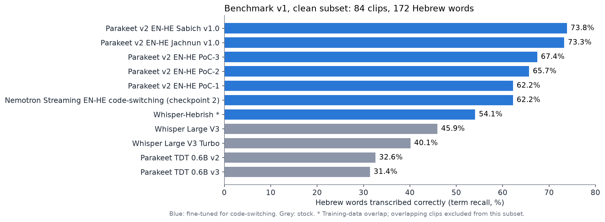

# English-Hebrew Code-Switching ASR Benchmark

A replicable benchmark for speech recognition on **English speech with Hebrew words in it**: *"pick up some bamba from the makolet"*, *"I have to go to Bituach Leumi tomorrow"*. It scores stock models and code-switching fine-tunes on the same frozen test set, with the same normaliser and term matcher.

> **Status: early-stage, work in progress (test set v1).** Known issue: 22 of the 139 labelled terms are English tech words or product names, not Hebrew (*JSON*, *grep*, *Proxmox*, ...). Ranks are unaffected; absolute term recall is 2 to 6 points high. v1.1 will relabel them and rescore every model from its stored transcripts. Contributions welcome (see [Known issues](docs/about.md#limits)): more speakers, better labels, more models.

| | |
|---|---|
| **Website** (the Parakeet code-switching fine-tune) | [hebrish.app](https://hebrish.app): get the Hebrish keyboard for Android and the desktop apps, see the results, and find every model, dataset and demo in one place |
| **Leaderboard** | [HF Space: English-Hebrew-Codeswitching-ASR-Leaderboard](https://huggingface.co/spaces/danielrosehill/English-Hebrew-Codeswitching-ASR-Leaderboard) |
| **Test set** | [HF dataset: English-Hebrew-Codeswitching-ASR-Benchmark](https://huggingface.co/datasets/danielrosehill/English-Hebrew-Codeswitching-ASR-Benchmark): v1, pinned commit in [`ehcs_bench/data.py`](ehcs_bench/data.py) |
| **Methodology, contamination, limits** | [`docs/about.md`](docs/about.md) |
| **Write-up** | [How good is speech-to-text at Hebrew words in English? I built a benchmark to find out](https://blog.danielrosehill.com/posts/english-hebrew-code-switching-asr-benchmark) (blog, 2026-10-15) |

## Results (test set v1, clean subset: 84 clips, 172 Hebrew term occurrences)

<!-- results:start -->
| Model | Type | Term recall % | Unseen-term recall % | Lenient % | WER % | English control WER % |
|---|---|---|---|---|---|---|
| [Parakeet v2 EN-HE code-switching (v3)](https://huggingface.co/danielrosehill/Parakeet-TDT-0.6B-v2-English-Hebrew-Codeswitching) | CS fine-tune | **67.4** | 63.2 | 70.3 | 4.0 | 2.5 |
| [Parakeet v2 EN-HE code-switching (v2)](https://huggingface.co/danielrosehill/Parakeet-TDT-0.6B-v2-English-Hebrew-Codeswitching/tree/e1541065f8bda57565f6ea404af27db7c868369e) | CS fine-tune | **65.7** | 60.7 | 67.4 | 4.2 | 2.4 |
| [Parakeet v2 EN-HE code-switching (v1)](https://huggingface.co/danielrosehill/Parakeet-TDT-0.6B-v2-English-Hebrew-Codeswitching/tree/ebc0e7aff15ed17b457d69639ab817345ea36ca2) | CS fine-tune | **62.2** | 61.5 | 63.9 | 4.6 | 2.5 |
| [Whisper-Hebrish](https://huggingface.co/danielrosehill/Whisper-Hebrish) ⚠ | CS fine-tune | **54.1** | 56.4 | 56.4 | 6.5 | 4.7 |
| [Whisper Large V3](https://huggingface.co/openai/whisper-large-v3) | Stock | **45.9** | 46.2 | 47.7 | 7.5 | 2.4 |
| [Whisper Large V3 Turbo](https://huggingface.co/openai/whisper-large-v3-turbo) | Stock | **40.1** | 39.3 | 41.9 | 8.9 | 2.4 |
| [Parakeet TDT 0.6B v2](https://huggingface.co/nvidia/parakeet-tdt-0.6b-v2) | Stock | **32.6** | 32.5 | 34.3 | 9.5 | 2.7 |
| [Parakeet TDT 0.6B v3](https://huggingface.co/nvidia/parakeet-tdt-0.6b-v3) | Stock | **31.4** | 31.6 | 35.5 | 10.5 | 2.7 |
<!-- results:end -->



**Term recall** is the share of Hebrew words written with the canonical romanized spelling, as a whole word and case-insensitive. It is the headline number, because a model can score a low WER and still mangle every Hebrew word. **Unseen-term recall** counts only words absent from the public training split. **Lenient** recall also accepts lexicon spelling variants. ⚠ marks a model with known training-data overlap: see the leaderboard. All test clips come from one speaker reading aloud, so treat gaps of a few points as noise ([limits](docs/about.md#limits)).

## Run it

```bash
uv venv && source .venv/bin/activate
uv pip install -e '.[whisper]'          # or '.[nemo]' for Parakeet / Canary
ehcs-bench run --model whisper:openai/whisper-large-v3-turbo --name "Whisper Large V3 Turbo"
ehcs-bench run --model nemo:nvidia/parakeet-tdt-0.6b-v2 --name "Parakeet TDT 0.6B v2"
```

A model spec is `<adapter>:<hf repo>[@revision]`; the resolved revision is recorded in the result. On a Modal GPU, with the NeMo build known to work:

```bash
MODAL_PROFILE=danielrosehill modal run modal_app.py \
  --model nemo:danielrosehill/Parakeet-TDT-0.6B-v2-English-Hebrew-Codeswitching \
  --name "Parakeet v2 EN-HE code-switching (v2)" --args "--fine-tuned --base-model nvidia/parakeet-tdt-0.6b-v2"
```

**Models that do not run here** (APIs, phone apps, GGUF runtimes): transcribe the 145 WAVs from the dataset yourself and write one `{"id": ..., "hyp": ...}` per line. Then run:

```bash
ehcs-bench score --preds preds.jsonl --name "My model" --model-id org/model
```

`ehcs-bench rescore results/*.json` recomputes every metric from the stored transcripts and prints `OK` when it matches.

## Adding a result to the leaderboard

Put the result file in `results/`. Then run `python3 scripts/results_table.py` to refresh the table above, `scripts/make_figures.py` to redraw the charts, and `scripts/deploy_space.sh` to publish the Space. When a batch of new results is complete, freeze it as a dated round: `python3 scripts/snapshot_run.py --title "Round N: ..." --notes "..."`, commit, then deploy. Outside contributors open a PR with the result file. See [submitting](docs/about.md#submitting-a-result).

## Layout

| Path | What |
|---|---|
| `ehcs_bench/score.py` | Normaliser, term matcher, all metrics. CPU only. |
| `ehcs_bench/adapters.py` | `nemo` and `whisper` model adapters. Add new families here. |
| `ehcs_bench/data.py` | Pinned test-set revision and loader |
| `ehcs_bench/cli.py` | `ehcs-bench run / score / rescore` |
| `modal_app.py` | GPU runner on Modal |
| `results/` | One JSON per model: model metadata, metrics, every transcript. The latest result per model |
| `archive/` | One JSON per published benchmark round (`scripts/snapshot_run.py`). Append-only; the Space's *Archive* tab |
| `docs/data-dictionary.md` | Every term, field and metric. The Space's *Data dictionary* tab |
| `scripts/make_figures.py` | Static PNG charts into `docs/figures/` (`uv run --with matplotlib python scripts/make_figures.py`) |
| `scripts/build_testset.py` | Rebuilds the test set from pinned upstream commits |
| `docs/dataset-card/README.md` | Source of the HF dataset card. Upload it with `hf upload ... README.md --repo-type dataset` (a card-only commit; the pinned revision does not change) |
| `scripts/deploy_space.sh` | Publishes `space/` + `results/` to the leaderboard Space |
| `space/app.py` | The Gradio leaderboard |

## Related

- [Parakeet code-switching fine-tune tracker](https://github.com/danielrosehill/English-Hebrew-Codeswitching-Parakeet-Finetune)
- [Whisper-Hebrish](https://huggingface.co/danielrosehill/Whisper-Hebrish)
- [English-Hebrew Code-Switching Index](https://github.com/danielrosehill/English-Hebrew-Code-Switching-Index)

Code MIT. Test-set audio CC-BY-4.0.
